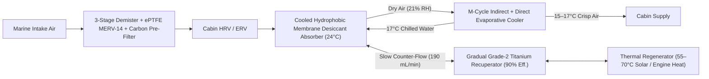

# XeroDorade

**Marine Liquid-Desiccant & Indirect/Direct Evaporative Dehumidifier / Air Conditioner with Gradual Titanium Heat Recovery**

`xero-dorade` (**XeroDorade** — combining *Xero-* [dry] and *Dorade* [the classic marine deck ventilation box that separates water from air]) is an ultra-low-power marine HVAC and cabin dehumidification project. It decouples latent humidity removal from sensible cooling using **internally cooled hydrophobic membrane liquid-desiccant contactors**, a **gradual slow-flow Grade 2 Titanium recuperative heat exchanger**, **Indirect + Direct Evaporative Cooling (`IDEC` / Maisotsenko M-Cycle)**, and **3-stage marine salt-aerosol pre-filtration with cabin energy recovery (`HRV/ERV`)**.

---

## Why XeroDorade?

In humid coastal and tropical anchorages (`30°C–35°C`, `70%–85% RH`), `65%–75%` of a boat's air-conditioning load is **latent humidity removal**:
* **Vapor-compression marine AC** must chill air to `8°C–10°C` just to condense moisture, drawing **`500 W to 2,000 W` of battery power**.
* **Standard evaporative ("swamp") coolers** fail in humid marine air because the high relative humidity leaves almost no wet-bulb depression.

**XeroDorade** solves both problems:
1. **Isothermal Liquid-Desiccant Drying:** Pre-filtered air passes across a cooled **microporous hydrophobic `ePTFE`/`PP` membrane contactor** (`0.2 µm` pores—zero corrosive droplet carryover even at `45°` boat heel) where concentrated liquid desiccant (`LiCl`, `CaCl2`, or `Potassium Formate`) strips relative humidity down to **`20%–22% RH`** (dropping the air's dew point to `~3°C` and wet-bulb to `~13.5°C`).
2. **Maisotsenko Cycle (`M-Cycle`) Indirect + Direct Evaporative Cooling (`IDEC`):** Once pre-dried, simple water evaporation chills both **cabin supply air (`14°C–17°C` at `45% RH`)** and the **cold water loop (`16°C–19°C`)** that keeps the liquid desiccant cold during absorption.
3. **Gradual Titanium Slow-Flow Recuperator (`90%+` Effectiveness):** Because the desiccant circulation rate is very slow (`~150–250 mL/min`), a long-residence-time counter-flow **ASTM Grade 2 Titanium** heat exchanger recovers `90%+` of sensible heat between the hot concentrated stream leaving the regenerator (`65°C`) and the cool dilute stream leaving the absorber (`24°C`).
4. **Powered by Free Solar / Engine Heat + Self-Sustaining Water Balance:** Desiccant regeneration (`55°C–70°C`) runs directly off `HelioStrake` PV/T deck panels, a `PhaseBallast` thermal battery, or engine waste heat, while condensing the regenerator vapor against seawater harvests **`1.0–1.5 L/hr` of pure distilled water**—more than enough to feed the evaporative cooler (`55–80 W` total DC electrical draw; **Electrical COP `12–22`**).

---

## System Architecture

---

## Repository Contents

* **[`liquid-desiccant-idec-hvac-guide.md`](liquid-desiccant-idec-hvac-guide.md)** — Complete engineering guide covering psychrometric physics, 3-stage salt-aerosol pre-filtration, liquid desiccant chemistry comparison (`LiCl`, `CaCl2`, `HCOOK`), heel-proof 3-fluid hydrophobic membrane contactors, NTU/effectiveness math for the gradual Titanium slow-flow recuperator, `M-Cycle` `IDEC` integration, self-sustaining water condensation mass balance, and DIY vs. commercial product blueprints.

---

## Development Roadmap

- [x] **Phase 0: Psychrometric & Subsystem Engineering Specification**
  - Define 4-loop integrated cycle (Pre-filter/HRV $\rightarrow$ Cooled Membrane Absorber $\rightarrow$ Gradual Titanium Recuperator + Thermal Regenerator $\rightarrow$ `M-Cycle` `IDEC`).
- [ ] **Phase 1: Gradual Titanium Recuperator & Membrane Contactor Bench Test**
  - Build and test the `6-meter` coaxial Grade 2 Titanium counter-flow recuperator at `150–250 mL/min` (`LiCl` / `CaCl2` brine) to verify `≥90%` thermal effectiveness.
  - Validate 3-fluid internally cooled `ePTFE` flat-sheet/hollow-fiber membrane contactor at `0°–45°` tilt angles with zero salt carryover.
- [ ] **Phase 2: Integrated `1.5 kW` (`5,100 BTU/hr`) Prototype Cabin Unit**
  - Couple membrane absorber/regenerator with `M-Cycle` `IDEC` core, 3-stage marine intake filter, and `HelioStrake` / `PhaseBallast` `65°C` hot water regeneration loop.
