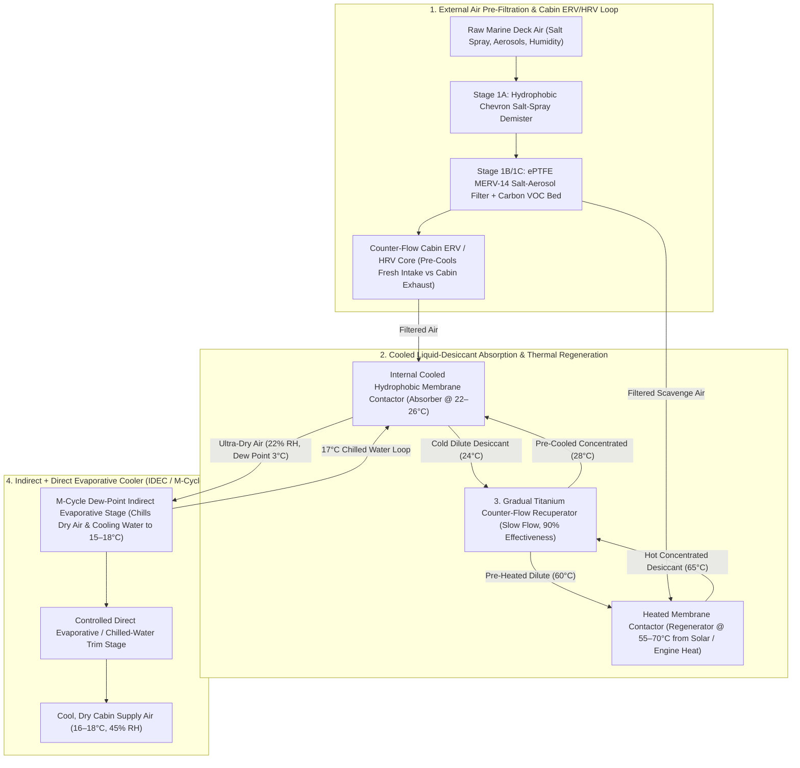
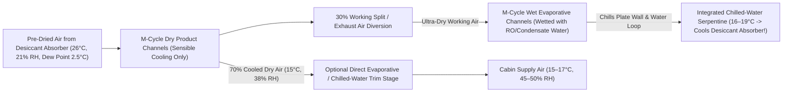

# Marine Liquid-Desiccant & Indirect/Direct Evaporative Dehumidifier / Air Conditioner: Engineering & Production Guide

**XeroDorade** (`xero-dorade` — combining *Xero-* [dry] and *Dorade* [the classic marine deck ventilation box that separates water from air]) is an advanced marine HVAC architecture that combines **Liquid Desiccant Dehumidification**, **Indirect + Direct Evaporative Cooling (`IDEC` / Maisotsenko M-Cycle)**, a **Gradual Slow-Flow Titanium Counter-Flow Heat Exchanger**, and **Multi-Stage Pre-Filtered Energy Recovery Ventilation (`ERV/HRV`)**.

---

## 1. Why Liquid-Desiccant + Evaporative Cooling on a Boat?

In humid coastal and tropical anchorages (`30°C–35°C` at `70%–85% RH`), traditional marine air conditioning faces two severe bottlenecks:
1. **The Latent Humidity Penalty of Vapor-Compression AC:**
   * `65%–75%` of a boat's cooling load in humid climates is **latent load** (condensing water vapor out of the air), not sensible temperature reduction.
   * A compressor AC must chill the entire airstream below its dew point (`~8°C–10°C`) just to wring out moisture, drawing **`800 W to 2,000 W` of continuous electrical power** from the house battery bank or requiring a noisy diesel generator.
2. **Why Standard Evaporative ("Swamp") Coolers Fail at Sea:**
   * Standard direct/indirect evaporative coolers rely on the difference between dry-bulb and wet-bulb temperature. At `32°C` and `80% RH`, the wet-bulb temperature is `29.1°C`—giving almost zero cooling while making the cabin damp and moldy.

### The XeroDorade Breakthrough: Decoupling Humidity from Evaporative Cooling
By stripping moisture out of the air *first* using a **cooled liquid desiccant membrane contactor**:
1. Ambient or cabin air at `32°C / 75% RH` (humidity ratio $\omega = 22.5\text{ g/kg}$, dew point `27.0°C`) is chemically dried at constant temperature (`~25°C–28°C` via internal cooling) down to **`20%–25% RH`** ($\omega = 4.5\text{ g/kg}$).
2. **The Psychrometric Magic:** At `27°C` and `22% RH`, the air's **wet-bulb temperature drops to `14.0°C`** and its **dew-point temperature drops to `3.2°C`**!
3. Now fed into an **Indirect + Direct Evaporative Cooler (`IDEC` / M-Cycle)**, simple water evaporation chills both:
   * **The cabin supply air** down to **`15°C–18°C` at a crisp `45%–50% RH`**, AND
   * **The cold water loop (`16°C–20°C`)** that keeps the liquid desiccant cold during humidity absorption!
4. **Total Electrical Consumption:** Because desiccant regeneration is powered by **low-grade thermal energy** (`55°C–70°C` from `HelioStrake` PV/T deck panels, a `PhaseBallast` heat battery, or engine/exhaust waste heat), the entire cabin AC & dehumidifier runs on just **`40 W to 85 W` of DC electricity** (two quiet EC fans + two miniature peristaltic/diaphragm metering pumps, achieving an **Electrical COP of `12 to 22`**!).

---

## 2. Complete 4-Loop System Architecture

---

## 3. Deep Dive Into Each Engineering Subsystem

### Subsystem 1: Multi-Stage Marine Air Pre-Filtration & Cabin Ventilation (`ERV/HRV`)
Why is air pre-filtration critical before air enters the humidity extraction contactor, the external evaporative loop, and the cabin `ERV`?
* **The Marine Aerosol Problem:** Ocean air contains `10 to 500 µg/m³` of airborne sea-salt crystals (`NaCl`, `MgCl2`, `CaSO4`), plus marina diesel soot, pollen, and biological spores.
  * If `NaCl` aerosols enter the **liquid desiccant loop**, sodium chloride has much lower solubility than `LiCl` or `CaCl2` (`salting-out effect`) and will precipitate as hard salt scale inside the micro-channels and membrane pores!
  * If salt aerosols or dust enter the **evaporative cooling wet channels**, they crust the hydrophilic wicks and breed biofilm.
* **The 3-Stage Marine Intake Filter Cassette:**
  1. **Stage 1A — Louvered Hydrophobic Demister (`Dorade` Baffle + Monofilament PP Coalescer):** Strips green water spray and coarse droplets (`>20 µm`), draining them directly back to the deck scuppers.
  2. **Stage 1B — Pleated `ePTFE` / Hydrophobic Micro-Glass `MERV 14` (`ISO ePM1 80%`) Filter:** Captures dry sub-micron sea-salt crystals (`0.3–5 µm`), pollen, and mold spores with low pressure drop (`<35 Pa` at oversized face area). Because the media is hydrophobic, high marine humidity does not cause filter blinding or water-logging.
  3. **Stage 1C — Activated Carbon / Potassium Permanganate Honeycomb (`15 mm`):** Adsorbs diesel exhaust hydrocarbons, bilge odors, and volatile organic compounds (`VOCs`).
* **Splitting the Pre-Filtered Air Across 3 Branches:**
  * **Branch A (Fresh Cabin Make-Up Air, `25–50 CFM`):** Passes through a washable polymer **Counter-Flow Heat/Energy Recovery Exchanger (`HRV/ERV`)** against outgoing stale `22°C` cabin air (`80%` sensible recovery), then joins the cabin recirculation stream entering the **Internal Desiccant Absorber**.
  * **Branch B (External Evaporative Working Air):** Clean, pre-filtered air feeds the wet working channels of the external evaporative cooler (boosted by the ultra-dry cabin exhaust air exiting the `HRV`).
  * **Branch C (External Desiccant Regenerator Scavenge Air):** Clean, pre-filtered air flows through the heated **Regenerator Contactor** to carry boiled-off moisture overboard (or into a seawater-cooled condenser to harvest pure distilled fresh water!).

---

### Subsystem 2: Liquid Desiccant Selection & Heel-Proof Membrane Contactors

#### A. Comparing Liquid Desiccant Working Fluids

| Desiccant Solution | Operating Concentration | Equilibrium RH (@ `25°C`) | Regeneration Temp Needed | Viscosity & Pumping | Toxicity & Safety | Corrosion Profile |
| :--- | :--- | :--- | :--- | :--- | :--- | :--- |
| **Lithium Chloride (`LiCl` aqueous)** | `30% – 40% wt` | **`15% – 22% RH`** (Deepest drying $\rightarrow$ lowest dew point!) | **`50°C – 65°C`** (Matches `HelioStrake` solar panels!) | Low (`4–9 cP`) | Low volatility; non-flammable; irritating if ingested | **High Chloride Pitting:** Attacks `304/316` stainless; **100% safe with Grade 2 Titanium, `PP`, `PVDF`, `PTFE`, `PEEK`, `EPDM`**. |
| **Calcium Chloride (`CaCl2` aqueous)** | `35% – 43% wt` | `28% – 35% RH` | `58°C – 72°C` | Moderate (`6–14 cP`) | **Food/Pharma Grade Safe** (`$1/kg`, easiest for DIY) | Same chloride pitting on steel; **100% safe with Grade 2 Titanium & plastics**. |
| **Potassium Formate (`HCOOK` aqueous)** | `62% – 74% wt` | `22% – 28% RH` | `52°C – 68°C` | **Very Low (`3–6 cP`)** | **Biodegradable, Eco-Friendly, Non-Toxic** | Much lower corrosivity than chlorides; compatible with Titanium and polymers. |
| **Propylene Glycol / Triethylene Glycol (`TEG`)** | `85% – 95% wt` | `20% – 30% RH` | `75°C – 90°C` | High (`25–45 cP`) | Non-corrosive | Zero metal corrosion, but requires higher regeneration temp and trace vapor carryover control. |

* **Recommendation:**
  * **For Maximum Cooling Performance (`14°C` supply air):** **`36% Lithium Chloride (LiCl)`** or **`70% Potassium Formate (HCOOK)`**.
  * **For Low-Cost DIY Prototyping:** **`40% Food-Grade Calcium Chloride (CaCl2)`** (or a ternary `CaCl2 + LiCl` blend).

#### B. Solving Boat Heel (`0°–45°`) & Droplet Carryover: 3-Fluid Hydrophobic Membrane Contactors
In land-based industrial liquid desiccant systems, desiccant is sprayed over open packed towers. **On a boat, open spray towers are unacceptable**—heeling and wave slamming would splash corrosive salt brine into the ductwork and carry salt mist into the cabin.

* **The Marine Solution — Internally Cooled Microporous Hydrophobic Membrane Contactors:**
  * Both the **Absorber** (internal drying cycle) and the **Regenerator** (external moisture-rejection cycle) use **microporous hydrophobic `ePTFE` or `Polypropylene (PP)` membranes** (`pore size 0.1–0.2 µm`, porosity `75%`, wall thickness `40–100 µm`, either in **Hollow-Fiber bundles** or **Flat-Plate Micro-Channel cassettes**).
  * **Liquid Entry Pressure (`LEP > 2.0–3.5 bar`):** Because `PTFE`/`PP` is strongly hydrophobic and the desiccant has high surface tension (`~75–90 mN/m`—even higher than pure water!), liquid desiccant **cannot wet or pass through the `0.2 µm` pores**. Only **water vapor molecules (`0.0004 µm`)** diffuse across the membrane!
  * **100% Heel- and Inversion-Proof:** The liquid desiccant remains completely sealed inside closed micro-channels (`0.2–0.5 bar` operating pressure). You can heel the boat `45°` or invert the module with **zero liquid leakage and zero salt aerosol carryover into the cabin**.
  * **Internal Isothermal Cooling (3-Fluid Absorber Architecture):**
    * Absorbing `1.0 kg/hr` of water vapor releases **`~750 W` of latent + dilution heat** right inside the absorber.
    * To prevent the desiccant from warming up (which would raise its equilibrium vapor pressure and stop dehumidification), **cooling water (`17°C–22°C`) from the Indirect Evaporative Cooler (or seawater loop)** runs through adjacent internal polymer/titanium micro-channels inside the absorber cassette—absorbing the heat of sorption isothermally as fast as moisture is captured!

---

### Subsystem 3: The Gradual Titanium Counter-Flow Heat Exchanger (Slow-Flow Sensible Recuperator)

Between the **cold Absorber (`~24°C`)** and the **hot Regenerator (`~65°C`)**, desiccant must circulate continuously to carry absorbed water from the absorber to the regenerator and return concentrated desiccant back to the absorber.

#### A. Why Slow Flow + High-Effectiveness Titanium Recuperation is the Key to High COP
* Suppose the system removes **`1.2 kg/hr` (`1.2 L/hr`) of moisture** from the cabin (`~850 W` of latent dehumidification load).
* The desiccant concentration only needs to shift by **`3%–4%` per pass** (e.g., entering the absorber at `38% LiCl` and leaving diluted at `35% LiCl`).
* **Required Desiccant Circulation Flow Rate ($\dot{m}_{\text{des}}$):**
  $$\dot{m}_{\text{des}} \approx 1.2\text{ kg/hr} \times \frac{0.35}{0.38 - 0.35} = \mathbf{14.0\text{ kg/hr}} \quad (\approx \mathbf{11.5\text{ Liters/hour}} \text{ or } \mathbf{190\text{ mL/min}}!)$$
* Notice how **slow** this liquid flow is: just **`190 mL/min`** (`~3.2 mL/sec`)!
* If that `14 kg/hr` stream of hot concentrated desiccant (`65°C`, $c_p \approx 3.0\text{ kJ/kg·K}$) returned directly to the cold absorber (`24°C`) without a recuperator, it would dump **`480 W` of unwanted sensible heat** into the cold absorber and waste **`480 W` of thermal regeneration energy**!

#### B. Engineering the Gradual Titanium Counter-Flow Recuperator (`ε = 90%–93%`)
* **Why ASTM Grade 2 Commercially Pure Titanium?**
  * Hot (`65°C–75°C`) concentrated `LiCl` and `CaCl2` brines destroy `304` and `316L` stainless steel via **chloride pitting** and **stress-corrosion cracking (`SCC`)**.
  * Plastics (`PP`/`PTFE`) are corrosion-proof, but their low thermal conductivity (`0.2 W/m·K`) requires large surface areas.
  * **Grade 2 Titanium** (`k = 21.9 W/m·K`—**`100×` higher conductivity than plastic**) forms a self-healing passive `TiO2` oxide film that is **100% immune to boiling `LiCl`, `CaCl2`, and seawater corrosion for 50+ years**.
* **Geometry & Flow Design (Coaxial Tube-in-Tube or Micro-Channel Plate):**
  * **DIY & Boutique Spec — Helical Coaxial Titanium Tube-in-Tube:**
    * Inner tube: **`6.35 mm` (`1/4"`) OD × `0.5 mm` wall Seamless Grade 2 Titanium tubing** (`4.5 to 6.0 meters` long, coiled into a compact `250 mm` diameter flat pancake spiral).
    * Outer jacket: **`10.0 mm` ID `PP-R`, `PVDF`, or `12.7 mm` (`1/2"`) Grade 2 Titanium outer tube** wrapped in `20 mm` closed-cell `Armaflex` insulation.
    * **Hot concentrated desiccant (`65°C`)** flows slowly (`190 mL/min`, velocity `v ≈ 0.13 m/s`) through the inner titanium tube; **cold dilute desiccant (`24°C`)** flows in strict **counter-flow** (`v ≈ 0.08 m/s`) through the outer annulus.
  * **Thermal Performance Calculation:**
    * Heat capacity rate: $C = \dot{m} \cdot c_p = \frac{14}{3600}\text{ kg/s} \times 3000\text{ J/(kg·K)} = \mathbf{11.67\text{ W/K}}$.
    * With a `5.5-meter` long `6.35 mm` Titanium tube ($A \approx 0.11\text{ m}^2$) and overall heat transfer coefficient $U \approx 650\text{ W/(m}^2\text{·K)}$ in laminar micro-annulus flow:
      $$\text{NTU} = \frac{U \cdot A}{C} = \frac{650 \times 0.11}{11.67} \approx \mathbf{6.13} \implies \text{Effectiveness } \varepsilon = \frac{\text{NTU}}{1 + \text{NTU}} = \frac{6.13}{7.13} = \mathbf{86.0\%}$$
      *(Extending the Titanium coil to `8 meters` or using a corrugated/twisted-tape insert brings $\text{NTU} = 9.5 \implies \mathbf{\varepsilon = 90.5\%}$!)*
  * **Result of `90.5%` Effectiveness:**
    * Cold dilute desiccant (`24.0°C`) exits the Titanium recuperator at **`61.1°C`** (needing only a `3.9°C` / **`45 W` thermal top-up** before entering the `65°C` regenerator!).
    * Hot concentrated desiccant (`65.0°C`) exits the Titanium recuperator cooled all the way down to **`27.9°C`** before entering the absorber!

---

### Subsystem 4: Indirect + Direct Evaporative Cooling (`IDEC` / M-Cycle) Loop

Once the air leaves the cooled liquid-desiccant absorber at **`26°C` and `20%–22% RH`** ($\omega \approx 4.5\text{ g/kg}$, wet-bulb `13.4°C`, dew-point `2.5°C`), it has massive evaporative cooling capacity:

1. **Stage 1 — Indirect Evaporative Cooling (`IEC` / Maisotsenko Dew-Point Cycle):**
   * Built from a stack of thin (`0.3 mm`) corrugated **hydrophilic-wicked polycarbonate/aluminum-laminate or `PP` plates** separating **Dry Product Channels** from **Wet Working Channels**.
   * `70%` of the dry air flows through the Dry Product Channels and is cooled **without adding any moisture** from `26°C` down to **`14.5°C–16.5°C`** (approaching the `2.5°C` dew point!).
   * The remaining `30%` of the dry air (plus dry cabin exhaust air leaving the `HRV`) is routed into the **Wet Working Channels**, where a thin wicked film of fresh water evaporates into the dry airstream.
   * **Cooling the Desiccant Absorber Simultaneously:** Embedded micro-tubes or a water sump in the wet evaporative stage chills a closed loop of water down to **`16°C–19°C`**, which is pumped back through the internal cooling channels of the **Liquid Desiccant Absorber** (keeping the desiccant cold!).
   * *(Bonus Marine Synergy: Whenever local seawater is `<22°C`, a small Titanium/Cupronickel seawater coil can assist or replace the evaporative water chiller for the absorber!)*
2. **Stage 2 — Controlled Direct Evaporative (`DEC`) or Chilled-Water Trim:**
   * Because the air exiting the Dry Channels of the `IEC` is at `15.5°C` and `~38% RH` (still very dry!), passing it across a brief **Direct Evaporative ultrasonic/wick trim pad** adds just `1.0–1.5 g/kg` of clean moisture to drop the final cabin supply temperature another **`2.5°C–3.5°C` down to `12.5°C–13.5°C` at `50% RH`**!
   * Alternatively, if `0%` moisture addition is desired in ultra-humid weather, bypass the direct pad and send the crisp `15.5°C / 38% RH` air straight into the cabin to aggressively dry out wet foul-weather gear, bedding, and bilges.

---

### Self-Sustaining Fresh Water Balance (Harvesting Water From Marine Air!)
A frequent question with marine evaporative cooling is: *"Doesn't evaporative cooling consume precious fresh water from the boat's tanks?"*
* **The Mass-Balance Reality:**
  * In a humid anchorage (`30°C`, `78% RH`), the liquid desiccant absorber extracts **`1.2 to 1.8 Liters/hour` of water** out of the humid ambient and cabin air.
  * Meanwhile, the `IDEC` evaporative cooler evaporates only **`0.8 to 1.1 Liters/hour` of water** to provide `650–800 W` of sensible cooling!
  * By passing the hot, moisture-saturated air leaving the `65°C` **Desiccant Regenerator** (`~55°C` dew point) through a compact **seawater-cooled polymer/titanium condensing coil (`25°C–28°C` seawater)** before venting it overboard, **`75%–85%` of the extracted humidity condenses into pure distilled water (`~1.0–1.4 L/hr`)**!
  * After passing through a small remineralization/carbon cartridge, the humidity extracted from the muggy marine air **completely supplies 100% of the water needed by the evaporative cooler**, making the system **water-positive**!

---

## 4. Sizing & Performance Benchmark (`1,500 W` / `5,100 BTU/hr` Cabin Unit)

| Metric | Traditional Marine Compressor AC (`5,000 BTU/hr`) | `XeroDorade` Liquid-Desiccant + IDEC Unit |
| :--- | :--- | :--- |
| **Latent Dehumidification Capacity** | `~0.6 L/hr` (`~420 W` latent, poor when cabin is cool) | **`1.2 – 1.6 L/hr` (`850 – 1,100 W` latent, works even at `18°C`!)** |
| **Sensible Cooling Capacity** | `~1,050 W` | **`650 – 900 W`** (`14°C–16°C` dry supply air) |
| **Total Cooling + Dehumidification Effect** | `~1,470 W` (`5,000 BTU/hr`) | **`1,500 – 2,000 W` (`5,100 – 6,800 BTU/hr` equivalent)** |
| **Electrical Power Draw (DC)** | **`480 W – 650 W`** (`40–54 Amps @ 12V`) | **`55 W – 80 W`** (`4.5–6.5 Amps @ 12V` — **`88%` less battery draw!**) |
| **Thermal Regeneration Input (`58°C–68°C`)** | `N/A` (All-electric) | **`950 – 1,250 W_th`** *(Free from `HelioStrake` solar deck, `PhaseBallast` hot battery, or engine waste heat)* |
| **Compressor Noise & Startup Surge** | High (`55–62 dBA` + compressor cycling thump) | **Whisper-Quiet (`34–39 dBA`, EC fans + `190 mL/min` metering pump)** |
| **Heel Angle Capability** | Up to `15°–20°` (oil starvation on steeper heels) | **`0° to 45°+` continuous heel** (sealed hydrophobic membranes) |

---

## 5. DIY Prototype vs. Commercial Product Roadmap

### A. DIY Prototype Build (`~$650 – $1,100` Bench / Single-Cabin Unit)
1. **Membrane Contactors (Absorber & Regenerator):**
   * Modify two commercial **polypropylene (`PP`) or `PTFE` hollow-fiber membrane humidifier/dehumidifier cartridges** (or build a flat-plate stack using `150 × 300 mm` CNC-routed `PP` micro-channel plates lined with **`0.2 µm` hydrophobic `ePTFE` membrane sheet** (`Sterlitech` / `Donaldson Tetratex`) and interleaved with thin `0.5 mm` polycarbonate/titanium cooling water channels).
2. **Gradual Titanium Slow-Flow Recuperator:**
   * Coil **`6 meters` of `1/4"` (`6.35 mm` OD × `0.5 mm` wall) Seamless Grade 2 Titanium tubing** (`~$45` on McMaster/eBay) inside a **`3/8"` ID (`10 mm`) flexible `PEX` or `PP` outer hose** using Titanium compression tee fittings at each end to create a `6-meter` true counter-flow coaxial heat exchanger, insulated in `Armaflex`.
3. **Metering Pumps:**
   * Two miniature `12V / 24V` brushless **peristaltic pumps (`Santoprene` / `Norprene` tubing)** or **`PTFE/EPDM` diaphragm dosing pumps** set to `150–250 mL/min` (`<6 W` total power).
4. **Indirect/Direct Evaporative Core (`IDEC`) & Pre-Filter:**
   * Use a commercial polypropylene cross/counter-flow enthalpy/IEC core with `50%` of channels wicked with hydrophilic microfiber fleece (`3M Thinsulate` hydrophilic veil or sintered PE sheet), preceded by a `MERV 14` pleated hydrophobic marine intake filter and stainless mesh salt-mist coalescer.

### B. Commercial Product Architecture (`XeroDorade` Deck-Box / Locker Unit)
* **Form Factor:** Low-profile (`600 × 450 × 220 mm`) composite marine unit designed to mount under a salon settee, inside a hanging locker, or integrated directly beneath a companionway/dorade plenum.
* **Core Bill of Materials:**
  1. **Snap-In 3-Stage Marine Pre-Filter Cartridge** (Washable PP salt-mist demister + replaceable `ePTFE MERV 14` + carbon cassette).
  2. **Injection-Molded `PP` / Ultrasonic-Welded `ePTFE` 3-Fluid Membrane Contactor Modules** (identical modular cassette used for both Absorber and Regenerator).
  3. **Laser-Welded Grade 2 Titanium Micro-Channel Recuperative Plate** (`150 × 80 × 15 mm`, `92%` thermal effectiveness at `200 mL/min`).
  4. **Molded Polymer M-Cycle Dew-Point `IDEC` Core + Washable Counter-Flow `HRV` Core** with integrated seawater-cooled regenerator vapor condenser (making the unit self-sufficient in fresh water).
